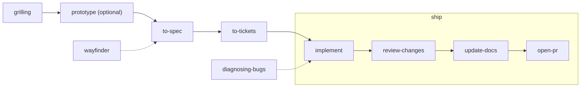

<p align="center">
  
</p>

<h1 align="center">MS Skills</h1>

<p align="center">
  <a href="https://github.com/matheus-sancha/MS-Skills/actions/workflows/validate.yml"></a>
  <a href="./LICENSE"></a>
</p>

A curated set of agent skills for [Claude Code](https://claude.com/claude-code)
and other Agent-Skills-compatible harnesses. The skills cover one engineering
workflow end to end — from stress-testing an idea to an open pull request —
plus the supporting vocabulary for design, testing, diagnosis, and review.

Each skill is short, loads only when needed, and is written to make an agent's
behaviour predictable rather than merely longer.

## Contents

- [Quick start](#quick-start)
- [The workflow](#the-workflow)
- [Skills](#skills)
- [Installation](#installation)
- [Repository layout](#repository-layout)
- [Authoring skills](#authoring-skills)
- [Credits](#credits)
- [License](#license)

## Quick start

In Claude Code:

```
/plugin marketplace add matheus-sancha/MS-Skills
/plugin install ms-skills@ms-skills
```

Then ask which skill fits what you are doing:

```
/ms-skills:which-skill
```

## The workflow

Most work travels one main flow. Other skills are on-ramps that merge onto it.



| Stage | Skill | Outcome |
|---|---|---|
| Decide | `grilling`, `domain-modeling`, `prototype` | No decision left open; terms agreed |
| Specify | `to-spec`, `to-tickets` | A spec issue, cut into independently verifiable tickets |
| Build | `implement` | One ticket built test-first, checks green |
| Verify | `review-changes` | The diff checked against repo standards and the spec |
| Deliver | `update-docs`, `open-pr` | Docs match the change; a pull request with evidence in its body |

`ship` runs Build through Deliver for one ticket in one session, stopping at
any gate that fails. It never merges.

## Skills

**Invocation** — *auto*: the agent may invoke the skill when the context
matches, and you can also call it by name. *slash*: runs only when you type
its command.

### Workflow

| Skill | Invocation | Purpose |
|---|---|---|
| [grilling](./skills/productivity/grilling/) | auto | Interview you relentlessly about a plan or design before anything is built |
| [prototype](./skills/engineering/prototype/) | auto | Build a throwaway prototype — a terminal app for logic, or switchable UI variations |
| [to-spec](./skills/engineering/to-spec/) | auto | Turn decisions made in the conversation into a spec issue on GitHub |
| [to-tickets](./skills/engineering/to-tickets/) | slash | Split a spec into vertical-slice tickets with blocking links |
| [implement](./skills/engineering/implement/) | slash | Build one ticket test-first, with check output shown as evidence |
| [review-changes](./skills/engineering/review-changes/) | auto | Review a diff on two axes: repo standards, and fidelity to the spec |
| [update-docs](./skills/engineering/update-docs/) | auto | Fix exactly the README and docs a branch or pull request made untrue |
| [open-pr](./skills/engineering/open-pr/) | auto | Open a pull request whose body carries the evidence; template included |
| [ship](./skills/engineering/ship/) | slash | One ticket from build to open pull request, with a gate between each step |

### Design and quality

| Skill | Invocation | Purpose |
|---|---|---|
| [codebase-design](./skills/engineering/codebase-design/) | auto | Shared vocabulary for deep modules, interfaces, and seams |
| [domain-modeling](./skills/engineering/domain-modeling/) | auto | Pin down entities, relationships, and invariants in one ubiquitous language |
| [context-map](./skills/engineering/context-map/) | auto | Create and maintain `CONTEXT.md` and ADRs — the mental model and the record of why |
| [test-strategy](./skills/engineering/test-strategy/) | auto | Decide what deserves a test and which seam to write it at |
| [diagnosing-bugs](./skills/engineering/diagnosing-bugs/) | auto | Diagnosis discipline for hard bugs, built on a tight feedback loop |
| [lean-code-reviewer](./skills/engineering/lean-code-reviewer/) | auto | Review a whole codebase for waste and redundancy |
| [resolving-merge-conflicts](./skills/engineering/resolving-merge-conflicts/) | auto | Resolve an in-progress merge or rebase by each side's intent |

Three review tools exist, divided by **scope**: `review-changes` reviews a
diff, `lean-code-reviewer` reviews a whole codebase, and Claude Code's built-in
`/code-review` hunts bugs.

### Planning and sessions

| Skill | Invocation | Purpose |
|---|---|---|
| [which-skill](./skills/productivity/which-skill/) | slash | Route to the right skill, and decide when to continue, clear, compact, or hand off |
| [wayfinder](./skills/productivity/wayfinder/) | slash | Plan work too big for one session as a map of tickets on GitHub Issues |
| [research](./skills/productivity/research/) | auto | Investigate a question against primary sources, captured as a cited Markdown file |
| [handoff](./skills/productivity/handoff/) | slash | Compact the conversation into a handoff document for another session |
| [pickup](./skills/productivity/pickup/) | slash | Pick up from a handoff document, checking what drifted since it was written |
| [teach](./skills/productivity/teach/) | slash | Learn a skill or concept across multiple sessions |
| [skill-creator](./skills/productivity/skill-creator/) | auto | Principles and vocabulary for writing and testing skills |

### Flutter

| Skill | Invocation | Purpose |
|---|---|---|
| [flutter-desktop-app](./skills/engineering/flutter-desktop-app/) | auto | Blueprint for a local-first Flutter app shipped as a plain Windows zip |
| [flutter-ui-design](./skills/engineering/flutter-ui-design/) | auto | Design and audit adaptive Flutter UI: tokens, Material 3, layout, navigation |

## Installation

Choose one method. Using both makes every skill appear twice.

### Plugin (recommended)

The repository is a plugin marketplace containing one plugin, `ms-skills`.

```
/plugin marketplace add matheus-sancha/MS-Skills
/plugin install ms-skills@ms-skills
```

In the Claude desktop app, add `matheus-sancha/MS-Skills` as a marketplace
under the plugin settings and install `ms-skills` from there.

Skills are namespaced by the plugin: `/ms-skills:handoff`, `/ms-skills:ship`,
and so on. To update:

```
/plugin marketplace update ms-skills
```

### Symlinks (for authoring)

Symlinking gives un-namespaced commands (`/handoff`) that reflect edits in
your checkout immediately, which suits working on the skills themselves.

```bash
git clone https://github.com/matheus-sancha/MS-Skills
cd MS-Skills
```

**Windows**

```powershell
powershell -ExecutionPolicy Bypass -File scripts\link-skills.ps1 -DryRun   # preview
powershell -ExecutionPolicy Bypass -File scripts\link-skills.ps1           # apply
```

**macOS / Linux**

```bash
bash scripts/link-skills.sh
```

Both scripts link every skill into `~/.claude/skills` (Claude Code) and
`~/.agents/skills` (other Agent-Skills harnesses). After a `git pull`, no
re-installation is needed.

On Windows, use the PowerShell script: Git Bash's `ln -s` silently copies
instead of linking. Enable **Developer Mode** (Settings → System → For
developers) so links can be created without an elevated shell; without it the
script falls back to directory junctions, which behave the same for local
paths.

### Requirements

- Skills that create or read issues and pull requests (`to-spec`,
  `to-tickets`, `wayfinder`, `open-pr`) use the [GitHub CLI](https://cli.github.com/),
  or the GitHub MCP tools where `gh` is unavailable.
- The Flutter skills assume a Flutter SDK on the path.

## Repository layout

Everything under `skills/` is installed. Templates and human-facing docs live
outside it.

```
MS-Skills/
├── .claude-plugin/
│   ├── plugin.json          plugin manifest; lists every skill path
│   ├── icon.png             plugin icon
│   └── marketplace.json     makes the repo installable via /plugin
├── skills/
│   ├── engineering/         one folder per skill
│   └── productivity/
├── templates/example-skill/ worked example of a skill; not installed
├── scripts/
│   ├── link-skills.ps1      symlink installer for Windows
│   ├── link-skills.sh       symlink installer for macOS and Linux
│   ├── list-skills.sh       list every skill in the repo
│   ├── new-skill.sh         scaffold a new skill
│   └── validate.sh          validate frontmatter and the plugin manifest
├── docs/                    authoring guidance
└── .github/workflows/       CI: runs validate.sh
```

A skill is a folder containing `SKILL.md` and, where needed, UPPERCASE sibling
files that the agent reads only when a step calls for them.

## Authoring skills

```bash
bash scripts/new-skill.sh     # scaffold
bash scripts/validate.sh      # check before committing
```

- [CONTRIBUTING.md](./CONTRIBUTING.md) — layout, frontmatter, and the checklist.
- [docs/authoring-guide.md](./docs/authoring-guide.md) and
  [docs/trigger-writing-tips.md](./docs/trigger-writing-tips.md) — writing guidance.
- The [`skill-creator`](./skills/productivity/skill-creator/) skill — the
  principles these skills are held to, including how to test one.

## Credits

Much of this collection is adapted from
[Matt Pocock's skills](https://github.com/mattpocock/skills) (MIT), rewritten
to depend only on skills in this repository and to target GitHub Issues
directly: `codebase-design`, `diagnosing-bugs`, `domain-modeling`, `grilling`,
`handoff`, `implement`, `open-pr`, `prototype`, `research`,
`resolving-merge-conflicts`, `review-changes`, `teach`, `to-spec`,
`to-tickets`, `wayfinder`, and `which-skill`.

Selected techniques in `diagnosing-bugs`, `test-strategy`, `review-changes`,
and `skill-creator` come from
[obra/superpowers](https://github.com/obra/superpowers) (MIT).

## License

[MIT](./LICENSE).
